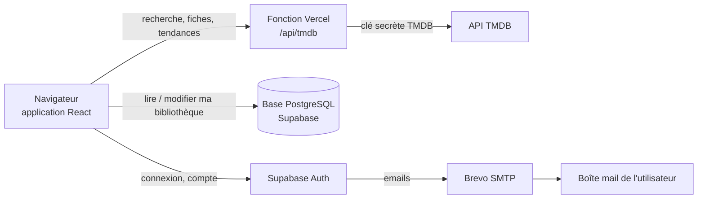
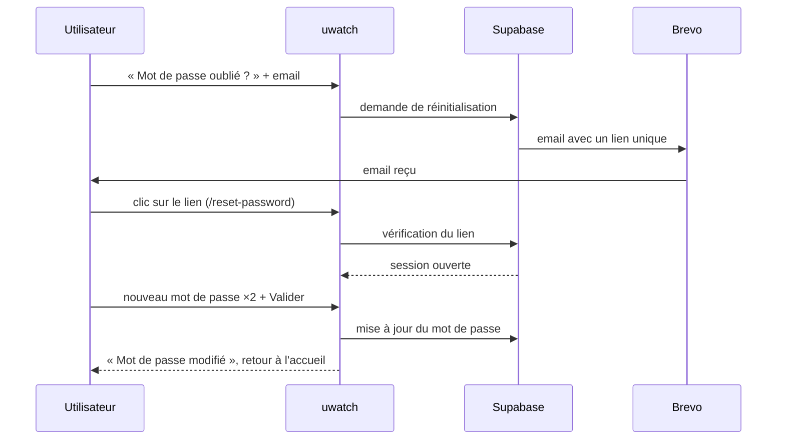

# uwatch

Application web pour suivre ses films et séries : **ce que j'ai vu, ce que je veux voir, et où j'en suis dans mes séries.**

**Site en ligne** : <https://movie-tracker-nassima1.vercel.app>

---

## Sommaire

1. [L'application en bref](#1-lapplication-en-bref)
2. [Ce que j'ai construit, étape par étape](#2-ce-que-jai-construit-étape-par-étape)
3. [Stack technique](#3-stack-technique)
4. [Architecture](#4-architecture)
5. [Sécurité](#5-sécurité)
6. [Organisation du code](#6-organisation-du-code)
7. [Lancer le projet en local](#7-lancer-le-projet-en-local)
8. [Tests et qualité](#8-tests-et-qualité)
9. [Méthode de travail](#9-méthode-de-travail)
10. [Pistes d'amélioration](#10-pistes-damélioration)

---

## 1. L'application en bref

| Fonctionnalité | Ce que l'utilisateur peut faire |
| --- | --- |
| Compte | Créer un compte, confirmer son email, se connecter, se déconnecter |
| Mot de passe oublié | Recevoir un lien par email, l'ouvrir dans n'importe quel navigateur, choisir un nouveau mot de passe (deux champs + critères cochés en direct) |
| Recherche | Trouver un film ou une série dès la première lettre (catalogue TMDB) |
| Statuts | Classer chaque titre : **À voir**, **En cours** ou **Vu** |
| Séries | Cocher les saisons vues et suivre sa progression (ex. 2/5 saisons) |
| Pages | Accueil avec tendances, À voir, En cours, Bibliothèque filtrable, fiches film et série |
| Affichage | Mode sombre / clair mémorisé, responsive mobile, tablette et ordinateur |
| Mode démo | Sans configuration, l'app fonctionne avec un catalogue intégré et des données locales |

---

## 2. Ce que j'ai construit, étape par étape

### Étape 1 : les fondations (8 octobre 2026)
- Création du projet **Vite + React + TypeScript**.
- Ajout des bibliothèques de base : Supabase, React Router, icônes Lucide.
- Première authentification avec **Google et GitHub (OAuth)** et routes protégées.

### Étape 2 : les données et l'API (8 octobre 2026)
- **Proxy TMDB** sous forme de fonction serveur Vercel : la clé TMDB reste côté serveur, jamais dans le navigateur.
- **Base de données PostgreSQL** (Supabase) : tables de la bibliothèque, contraintes et règles d'accès par utilisateur (RLS).
- Bibliothèque, recherche TMDB, interface complète et **mode démo**.
- Déploiement sur **Vercel** avec des en-têtes de sécurité stricts (CSP).

### Étape 3 : ajustements et première version (8 et 9 octobre 2026)
- Page d'accueil avec les **tendances TMDB** et une grande barre de recherche.
- Écran lisible en cas d'erreur au démarrage (plus de page blanche).
- Remplacement de l'OAuth par **email + mot de passe**, plus simple pour l'utilisateur.
- Nouveau statut **« En cours »** et sa page dédiée.
- Premier parcours **« mot de passe oublié »**.
- Index en base pour accélérer les suppressions.
- **Sortie du MVP 1.0.**

### Étape 4 : nettoyage du code (9 octobre 2026)
- Simplification du proxy TMDB et suppression du code OAuth devenu inutile.
- Commentaires du code traduits en français, pour qu'il soit lisible par toute l'équipe pédagogique.

### Étape 5 : authentification fiabilisée (2 novembre 2026)
En testant le site en conditions réelles, j'ai identifié trois problèmes et je les ai corrigés :

| Problème constaté | Cause trouvée | Correction |
| --- | --- | --- |
| Impossible de créer un compte | Une liste blanche en base n'autorisait qu'une seule adresse | Inscription ouverte à tous |
| Les emails n'arrivaient qu'à moi | Le service d'email gratuit de Supabase n'écrit qu'aux membres du projet | Envoi des emails via **Brevo** (SMTP) |
| Le lien « mot de passe oublié » renvoyait sur la connexion sans rien faire | Le robot de sécurité de Gmail « cliquait » le lien avant moi, et le lien ne marchait que dans le navigateur d'origine | Nouveau format de lien (`token_hash`) vérifié par l'application, valable dans n'importe quel navigateur |

J'ai aussi refait la page **« Créer un nouveau mot de passe »** : deux champs, critères qui se cochent en direct, bouton Valider, bouton Annuler, gestion des liens expirés.

### Étape 6 : ménage après les corrections (2 novembre 2026)
Une fois les problèmes corrigés, j'ai nettoyé ce qu'ils avaient laissé derrière eux :

- **Base de données** : la correction « inscription ouverte à tous » avait été faite directement dans Supabase. Le fichier de migration correspondant (`open_sign_up`) a été ajouté au dépôt : une nouvelle installation n'est plus bloquée par l'ancienne liste blanche.
- **Messages d'erreur** : suppression du message « adresse non autorisée », qui ne pouvait plus apparaître.
- **Code plus simple** : une seule règle décide d'envoyer vers la page « nouveau mot de passe » (la garde des routes privées), au lieu de trois endroits différents.
- **Textes corrigés** : l'app ne demande plus d'ouvrir le lien « dans ce navigateur », puisque ce n'est plus nécessaire.
- **Documentation** : commentaires OAuth obsolètes retirés, document MVP mis à jour (adresse du site, inscription ouverte).

---

## 3. Stack technique

| Couche | Technologie | Rôle dans le projet |
| --- | --- | --- |
| Langage | **TypeScript** | Typage du code front et serveur, moins d'erreurs à l'exécution |
| Interface | **React 19** | Composants de l'interface |
| Outil de build | **Vite** | Serveur de développement rapide et build de production |
| Navigation | **React Router** | Pages et routes protégées |
| Style | **Tailwind CSS 4** | Mise en page, thèmes clair et sombre, responsive |
| Données côté client | **TanStack Query** | Cache, chargement et mises à jour instantanées de la bibliothèque |
| Validation | **Zod** | Vérification des réponses de l'API TMDB |
| Authentification | **Supabase Auth** | Comptes, sessions, emails de confirmation et de réinitialisation |
| Base de données | **Supabase (PostgreSQL)** | Bibliothèque de chaque utilisateur, protégée par des règles RLS |
| Emails | **Brevo (SMTP)** | Envoi des emails d'authentification à n'importe quelle adresse |
| API externe | **TMDB** | Catalogue des films et séries (affiches, saisons, tendances) |
| Serveur | **Fonction Vercel** | Proxy sécurisé vers TMDB |
| Hébergement | **Vercel** | Déploiement automatique à chaque push sur `main` |
| Tests | **Vitest + Testing Library** | Tests unitaires et tests d'interface |
| Qualité | **ESLint + Prettier** | Règles de code et formatage automatique |

---

## 4. Architecture

L'application est une **SPA** (application monopage) : tout l'affichage se fait dans le navigateur, qui parle à deux services.



**En simplifiant :**

- **Le navigateur** affiche l'application React. Il ne contient aucun secret.
- **Supabase** gère les comptes et stocke la bibliothèque. Chaque ligne appartient à un utilisateur, et la base refuse elle-même de montrer à quelqu'un les données d'un autre.
- **La fonction Vercel `/api/tmdb`** sert d'intermédiaire avec TMDB. Elle garde la clé TMDB secrète, n'accepte que les requêtes prévues et vérifie que l'utilisateur est connecté.
- **Brevo** envoie les emails (confirmation de compte, mot de passe oublié).

**Le parcours « mot de passe oublié » :**



---

## 5. Sécurité

| Risque | Protection mise en place |
| --- | --- |
| Voir les données d'un autre utilisateur | Règles **RLS** dans PostgreSQL : chaque requête est filtrée par l'identité de la session |
| Usurper un autre utilisateur | Le navigateur n'envoie jamais d'identifiant : la base le déduit de la session |
| Vol de la clé TMDB | La clé reste sur le serveur Vercel, jamais dans le code envoyé au navigateur |
| Abus du proxy TMDB | Liste blanche des requêtes autorisées, paramètres validés, session obligatoire |
| Redirection piégée après connexion | Seules les adresses internes au site sont acceptées |
| Lien de réinitialisation réutilisé | Le lien est à usage unique et retiré de l'adresse dès qu'il a été vérifié |
| Injection de scripts | En-tête **Content-Security-Policy** strict sur tout le site |
| Messages d'erreur trop bavards | Les erreurs du serveur sont traduites en messages simples, sans détail technique |

---

## 6. Organisation du code

```
api/                    Fonction Vercel (proxy TMDB)
server/tmdb/            Logique du proxy : routes autorisées, vérification de session
src/
  app/                  Démarrage, routeur, fournisseurs globaux
  pages/                Une page = un fichier (accueil, connexion, nouveau mot de passe…)
  features/
    auth/               Connexion, inscription, mot de passe oublié, routes protégées
    catalog/            Accès à TMDB (et catalogue de démo)
    library/            Bibliothèque, statuts, progression des séries
    search/             Recherche instantanée
    media-details/      Fiches film et série
    theme/              Mode clair / sombre
  components/           Composants réutilisables (boutons, cartes, mise en page)
  lib/                  Outils partagés (client Supabase, configuration, formats)
supabase/
  migrations/           Création des tables et des règles de sécurité (identiques à la production)
  tests/                Tests de sécurité de la base
tests/                  Outils de test partagés
docs/                   Document de présentation du MVP
```

Chaque fonctionnalité est rangée dans son propre dossier, avec ses composants, sa logique et ses tests. L'authentification et la bibliothèque passent par une **interface commune**, qui permet de basculer entre Supabase et le mode démo sans changer le reste du code.

---

## 7. Lancer le projet en local

**Prérequis :** Node.js 22 ou plus.

```bash
git clone https://github.com/Nassima203/movie-tracker.git
cd movie-tracker
npm install
npm run dev
```

Le site s'ouvre sur <http://localhost:5173>.

- **Sans configuration**, l'application démarre en **mode démo** (catalogue intégré, données gardées dans le navigateur).
- **Avec les vrais services**, copier `.env.example` en `.env.local` et remplir :

| Variable | Où la trouver |
| --- | --- |
| `VITE_SUPABASE_URL` | Supabase, *Settings → API* |
| `VITE_SUPABASE_PUBLISHABLE_KEY` | Supabase, *Settings → API Keys* (clé publique) |
| `TMDB_READ_ACCESS_TOKEN` | themoviedb.org, *Paramètres → API* (secret, jamais préfixé par `VITE_`) |

**Réglages Supabase pour le mot de passe oublié :**

- *Authentication → URL Configuration* : ajouter `…/login` et `…/reset-password` aux Redirect URLs.
- *Authentication → Emails → Templates → Reset password* : le lien doit être
  `{{ .RedirectTo }}?token_hash={{ .TokenHash }}&type=recovery`.

---

## 8. Tests et qualité

```bash
npm run test        # tests unitaires et d'interface (Vitest)
npm run typecheck   # vérification TypeScript
npm run lint        # règles ESLint
npm run build       # build de production
```

Les tests (170) couvrent l'authentification (connexion, inscription, mot de passe oublié, liens expirés, routes protégées), la recherche, la bibliothèque, la progression des séries, le thème et le proxy TMDB.

---

## 9. Méthode de travail

Ce projet a été réalisé dans le cadre d'un module HETIC sur le **développement assisté par IA**. Le principe : partir d'une demande simple et aboutir à une application corrigée, testée et déployée.

- Le code a été généré avec **Claude Code**, à partir de mes demandes.
- J'ai relu, testé en conditions réelles et fait corriger le code jusqu'à ce que tout fonctionne.
- J'ai configuré moi-même la connexion à l'API TMDB, le projet Supabase, l'envoi d'emails avec Brevo et le déploiement Vercel.
- Lors de la mise en ligne, j'ai diagnostiqué les problèmes d'authentification à partir des journaux Supabase avant de les faire corriger (voir l'étape 5), puis fait nettoyer ce qu'ils avaient laissé dans le code (étape 6).

---

## 10. Pistes d'amélioration

- Nom de domaine personnel, pour que les emails ne partent plus d'une adresse Gmail.
- Lien de confirmation d'inscription au même format `token_hash` que le mot de passe oublié.
- Notes et avis personnels sur les titres.
- Suivi épisode par épisode, et pas seulement saison par saison.
- Statistiques (temps passé, genres préférés).

---

Données de films et séries fournies par [TMDB](https://www.themoviedb.org/). Ce produit utilise l'API TMDB mais n'est ni approuvé ni certifié par TMDB.
