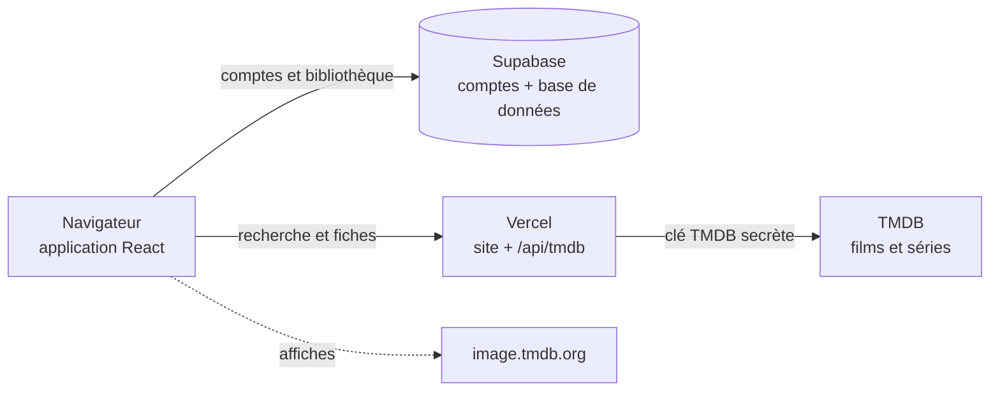

# uwatch — MVP 1.0

Octobre 2026 · Nassima

| Livrable                |                                                                                                    |
| ----------------------- | -------------------------------------------------------------------------------------------------- |
| Produit                 | uwatch, application web de suivi de films et séries                                                |
| Version                 | 1.0 (MVP)                                                                                          |
| Application en ligne    | [movie-tracker-theta-seven.vercel.app](https://movie-tracker-theta-seven.vercel.app)               |
| Code source             | [github.com/Nassima203/movie-tracker](https://github.com/Nassima203/movie-tracker), branche `main` |
| Documentation technique | [README](../README.md) du dépôt (en français)                                                      |

## En bref

uwatch 1.0 est en ligne : une application web personnelle pour savoir ce que j'ai vu, ce que je veux voir et où j'en suis dans mes séries. Le site est accessible sur [movie-tracker-theta-seven.vercel.app](https://movie-tracker-theta-seven.vercel.app).

Le MVP couvre le compte personnel, la recherche de films et séries via TMDB, trois statuts (À voir, En cours, Vu) et le suivi des séries saison par saison. Il est volontairement minimaliste : pas de notes, de critiques ni de réseau social.

Un seul compte peut s'inscrire : l'adresse autorisée dans la base. Les données de chaque utilisateur sont isolées par la base elle-même.

## Contexte et objectifs

**Le problème.** Entre les plateformes de streaming, le cinéma et les recommandations, il devient difficile de se souvenir de ce que l'on a vu, de ce que l'on veut voir, et de l'endroit où l'on s'est arrêté dans une série. Les notes dans le téléphone et les listes dispersées ne tiennent pas dans la durée.

**La cible.** Une personne qui regarde régulièrement films et séries et veut un outil personnel, simple et rapide, sans réseau social ni publicité.

**Ce que le MVP doit prouver.**

1. Retrouver n'importe quel film ou série en quelques secondes grâce au catalogue TMDB.
2. Classer chaque titre en un clic : À voir, En cours ou Vu.
3. Savoir instantanément où l'on en est dans une série, saison par saison.
4. Garder ses données privées et accessibles depuis n'importe quel appareil.

**Principes de conception.** Minimaliste (une seule chose bien faite), rapide (résultats dès la première lettre), accessible (clavier, lecteurs d'écran) et sécurisé dès la conception.

## Fonctionnalités

Toutes les fonctionnalités prévues pour le MVP sont livrées.

| Domaine   | Ce que l'utilisatrice peut faire                                                                                             |
| --------- | ---------------------------------------------------------------------------------------------------------------------------- |
| Compte    | Créer un compte (email + mot de passe, confirmation par email), se connecter, se déconnecter, réinitialiser son mot de passe |
| Recherche | Chercher un film ou une série dès la première lettre, au clavier ou à la souris, avec affiche, type et année                 |
| Statuts   | Marquer un titre À voir, En cours ou Vu, depuis la recherche ou la fiche                                                     |
| Séries    | Cocher les saisons vues une par une ou toutes d'un coup, voir la progression (ex. 2/5 saisons)                               |
| Pages     | Accueil (tendances de la semaine + listes), À voir, En cours, Bibliothèque filtrable, fiches film et série                   |
| Affichage | Mode nuit par défaut, mode jour, choix mémorisé ; photo de fond home cinéma ; mobile, tablette et ordinateur                 |

Les épisodes spéciaux (saison 0) et les saisons pas encore diffusées ne comptent pas dans la progression. Une série terminée repasse en cours quand une nouvelle saison sort.

## Parcours utilisateur

Chaque parcours tient en quelques clics, sans quitter la page en cours.

**Créer son compte**

1. Onglet « Créer un compte » : email, mot de passe (8 caractères minimum, lettres et chiffres), confirmation.
2. Un email de confirmation arrive ; le lien ramène sur le site.
3. Connexion avec l'email et le mot de passe : arrivée sur l'accueil.

**Mot de passe oublié**

1. « Mot de passe oublié ? » sous le champ mot de passe, puis saisie de l'email.
2. Le lien reçu par email, ouvert dans le même navigateur, mène à la page « Nouveau mot de passe ».
3. Le nouveau mot de passe est enregistré et l'utilisatrice arrive sur l'accueil.

**Suivre un film ou une série**

1. Taper le titre dans la recherche : les résultats apparaissent après 300 ms de pause.
2. Cliquer sur « À voir », « En cours » ou « Vu », ou ouvrir la fiche du titre.
3. Pour une série, cocher les saisons vues sur sa fiche : elle passe en cours, puis en vu quand toutes les saisons diffusées sont cochées.
4. Retrouver ses titres sur l'accueil et dans les pages À voir, En cours et Bibliothèque.

## Guide d'utilisation rapide

| Je veux…                   | Je fais…                                                                                                         |
| -------------------------- | ---------------------------------------------------------------------------------------------------------------- |
| Trouver un titre           | Je tape son nom dans la barre de recherche, en haut de la page. Flèches du clavier et Entrée fonctionnent aussi. |
| Le garder pour plus tard   | Je clique sur l'icône **À voir** dans les résultats ou sur la fiche.                                             |
| Indiquer que je le regarde | Je clique sur **En cours**.                                                                                      |
| Indiquer que je l'ai fini  | Je clique sur **Vu**.                                                                                            |
| Suivre une série           | J'ouvre sa fiche et je coche les saisons vues, ou **Tout marquer vu**.                                           |
| Retirer un titre           | Sur sa fiche, je clique sur **Retirer puis sur « Confirmer le retrait »**.                                       |
| Retrouver mes titres       | Menu **À voir**, **En cours** ou **Bibliothèque** (avec filtres par statut et par type).                         |
| Changer l'apparence        | Bouton soleil / lune en haut à droite.                                                                           |
| Me déconnecter             | Bouton de sortie à côté de mon initiale, en haut à droite.                                                       |

## Architecture

uwatch repose sur trois services :

- **Vercel** héberge le site.
- **Supabase** gère les comptes et enregistre la bibliothèque de chacun.
- **TMDB** fournit les films, les séries et les affiches.

Chaque modification publiée sur GitHub est mise en ligne automatiquement en une à deux minutes.

## Stack utilisée

Chaque outil a été choisi pour aller vite, rester simple et ne rien coûter au démarrage.

| Outil              | Rôle                         | Pourquoi ce choix                                                                                                   |
| ------------------ | ---------------------------- | ------------------------------------------------------------------------------------------------------------------- |
| **React**          | Construire l'interface       | La bibliothèque la plus utilisée : fiable, bien documentée, facile à faire évoluer.                                 |
| **TypeScript**     | Écrire le code               | Détecte les erreurs avant même de lancer le site, donc moins de bugs.                                               |
| **Vite**           | Lancer et construire le site | Très rapide : chaque modification s'affiche instantanément pendant le développement.                                |
| **Tailwind CSS**   | Mettre en forme              | Un design cohérent, le mode nuit / jour et l'adaptation au mobile sans effort.                                      |
| **TanStack Query** | Charger les données          | Garde les résultats en mémoire et met l'écran à jour immédiatement : le site paraît instantané.                     |
| **Supabase**       | Comptes et base de données   | Connexion, emails et base de données prêts à l'emploi, avec une sécurité intégrée. Gratuit pour un usage personnel. |
| **TMDB**           | Catalogue de films et séries | La base la plus complète, en français, avec les affiches. Gratuite pour un usage non commercial.                    |
| **Vercel**         | Héberger le site             | Mise en ligne automatique depuis GitHub et hébergement du petit serveur qui protège la clé TMDB. Gratuit.           |

**Alternatives écartées** : IMDb (pas d'accès gratuit et ouvert à ses données), un serveur fait maison (plus long à construire et à sécuriser que Supabase).

## Sécurité

- **Données privées** : chaque personne ne voit que sa propre bibliothèque. C'est la base de données elle-même qui l'impose.
- **Accès réservé** : seules les adresses email autorisées peuvent créer un compte.
- **Clés protégées** : aucune clé secrète n'est visible dans le site ni sur GitHub.

## Validation

Toutes les fonctionnalités prévues sont livrées, et 163 tests automatiques sont réussis.

| Fonctionnalité                                       | Statut |
| ---------------------------------------------------- | ------ |
| Compte : inscription, connexion, mot de passe oublié | ✅     |
| Recherche de films et séries                         | ✅     |
| Statuts À voir, En cours, Vu                         | ✅     |
| Suivi des séries saison par saison                   | ✅     |
| Pages À voir, En cours, Bibliothèque                 | ✅     |
| Mode nuit et mode jour                               | ✅     |
| Mobile, tablette et ordinateur                       | ✅     |
| Données privées et sécurisées                        | ✅     |

## Et après ?

**Volontairement absent de cette version** : le suivi épisode par épisode, les notes et les critiques, le partage.

**Idées pour la version 2** :

- trier les listes (date d'ajout, titre, année) ;
- afficher des statistiques (titres vus par mois) ;
- prévenir quand une nouvelle saison sort.

---

_Les données des films et séries proviennent de TMDB. Ce produit utilise l'API TMDB mais n'est ni approuvé ni certifié par TMDB._
